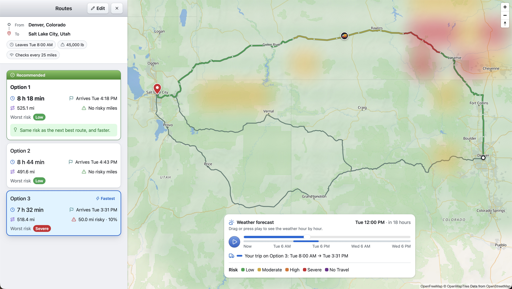
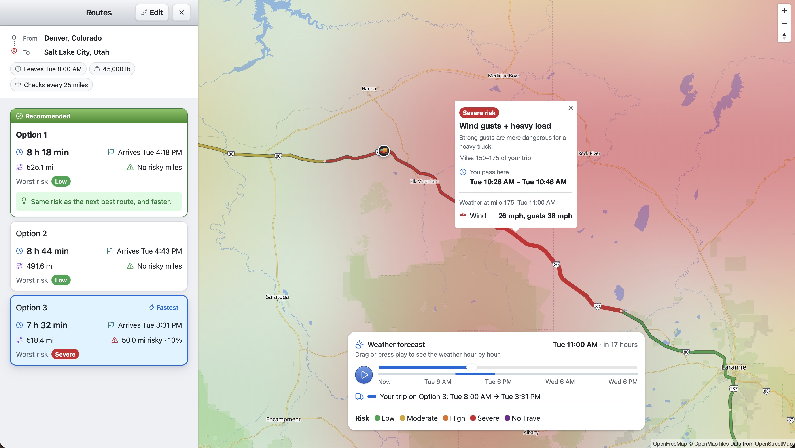

# 🚚 Truck Route Weather

Strong wind, heavy rain and snow make driving a big truck dangerous, and the weather can change during a
long trip. This web app helps a truck driver choose the safest of three routes between two US places.

For every route, it checks the weather forecast at the hour the truck will actually pass each point, rates
how risky that is for the truck's load, and recommends the safest route with a one-line reason.

🌐 **Live demo:** https://truck-route-weather.onrender.com

> ⏳ The demo runs on a free hosting plan that sleeps when nobody uses it. The first visit can take about a
> minute to load; after that it runs at normal speed.



## 🧭 How to use it

1. Type the **origin** and **destination** (any US city or address) and pick a suggestion from the list.
2. Choose the **departure**: leave now, or a date and time up to 7 days ahead.
3. Choose how often to **check the weather along the route**: every 10, 25 or 50 miles.
4. Enter the **truck weight** in pounds.
5. Press **Plan route**. You get up to three routes; the recommended one comes first.
6. Click a colored piece of a route to see why it is risky, when the truck passes there and the expected
   weather.
7. Use the **weather forecast slider** (or press play) to watch how the weather around the routes changes
   hour by hour over the next 48 hours.



## 🗺️ What the app shows

- **A card per route** with the driving time, arrival time, distance, how many miles are risky, and the
  worst risk level on it. The recommended route has a short reason, for example "Fewest Severe miles: 100.0
  vs 125.0 on the next best route", meaning it spends 25 fewer miles in Severe weather than the next option.
- **Routes colored by risk** on the map, from green (Low) to purple (No Travel).
- **A detail popup** for each piece of the route: the risk level, its cause (wind, rain, snow or the load),
  the miles of the trip it covers, when the truck passes, and the wind, rain and snow there.
- **A weather map** that shades the area around the routes by risk level, with a truck icon that moves
  along the selected route as you move the slider.
- ⚠️ **A warning** when even the safest route crosses No Travel weather, suggesting to delay the trip.
- **Works on phones**: on small screens the map fills the screen and the panel becomes a sheet you drag up
  from the bottom.

## 📖 Key terms

| Term | Meaning |
|---|---|
| Checkpoint | A point on the route where the app checks the weather, every 10, 25 or 50 miles. |
| Segment | The piece of route between two checkpoints. It takes the worse risk level of its two ends. |
| ETA | Estimated time of arrival: when the truck is expected to reach a checkpoint. |
| Risk level | How dangerous the weather is for the truck at that point: Low, Moderate, High, Severe or No Travel. |
| Risky miles | Miles of the route at High, Severe or No Travel. |
| Weather map (heatmap) | The colored shading on the map showing the risk level around the routes, hour by hour. |

## 🌦️ How the risk is decided

### Risk levels

At each checkpoint the app looks at the forecast for the hour the truck arrives. Wind gusts, rain and snow
each get a level, and the checkpoint takes the worst of the three.

| Level | What it means | 💨 Wind gusts (mph) | 🌧️ Rain (in/hr) | ❄️ Snow (in/hr) |
|---|---|---|---|---|
| 🟢 Low | Normal driving | < 25 | < 0.10 | < 0.5 |
| 🟡 Moderate | Drive with care | 25 – 35 | 0.10 – 0.25 | 0.5 – 1.0 |
| 🟠 High | Slow down, stay alert | 35 – 45 | 0.25 – 0.50 | 1.0 – 2.0 |
| 🔴 Severe | Dangerous; avoid if possible | 45 – 55 | 0.50 – 1.00 | 2.0 – 3.0 |
| 🟣 No Travel | Do not drive through | ≥ 55 | > 1.00 | > 3.0 |

### ⚖️ Load weight

A heavily loaded truck is harder to steer and needs more distance to stop, so strong gusts are more
dangerous for it. Two rules raise the wind level for heavy trucks:

- Gusts of 45–55 mph and a truck over 30,000 lb → **No Travel** (instead of Severe).
- Gusts of 35–45 mph and a truck over 40,000 lb → **Severe** (instead of High).

### ✅ Which route is recommended

The app compares the routes in this order and stops at the first difference:

1. Fewest miles at No Travel
2. Fewest miles at Severe
3. Fewest miles at High
4. Lowest average risk over the whole route (0 = all Low, 4 = all No Travel)
5. Shortest driving time

For example, if route A has 0 No Travel miles and 40 Severe miles, and route B has 0 No Travel miles and 10
Severe miles, route B wins on step 2, even if route A is faster.

## 🚧 Limitations

- **US only.** Places outside the United States are not accepted.
- **Routes are for cars.** The free routing plan has no truck profile, so routes don't avoid low bridges or
  roads closed to heavy trucks, and driving times are car times.
- **Only wind, rain and snow** are checked. Ice, fog, visibility, traffic and road closures are not.
- **Forecasts are less reliable further ahead**, so a trip several days away can change.
- **The weather map covers only the next 48 hours.** A trip that starts later still gets its risk ratings,
  but the map can't show it.
- **Free services have daily limits.** If the routing or weather service is busy, try again later.

---

# 🛠️ For developers

## How it works

```
Origin, destination, departure, weight, checkpoint spacing
  │
  ├─ Backend  POST /api/trip-plans
  │    1. GraphHopper: up to 3 alternative routes (line on the map + driving time along it)
  │    2. Checkpoints every N miles along each route, each with its ETA
  ├─ Browser  3. Open-Meteo: hourly forecast at every checkpoint
  ├─ Backend  POST /api/trip-risks
  │    4. Risk level per checkpoint at the forecast hour nearest its ETA (wind gusts, rain, snow, load weight)
  │    5. Miles at each level, average risk and worst level per route
  │    6. Ranking and the reason the first route wins
  └─ Heatmap  the browser gets 49 hours of forecasts for a grid around the routes;
              POST /api/heatmap turns them into a risk level per point and hour
```

The browser fetches the forecasts itself so Open-Meteo's free daily limit counts per visitor. When the
server fetched them, the hosting's shared outgoing IP hit that limit. All risk rules and the ranking stay in
the backend. The routes show first; the heatmap is requested afterwards, so the routes never wait for it.

## Tech stack

| Part | Choice |
|---|---|
| Backend | Python, Django 5.2, Django REST Framework, Gunicorn, WhiteNoise (no database) |
| Frontend | React 19, TypeScript, Vite, Tailwind CSS 4, shadcn/ui on Base UI |
| Map | MapLibre GL via `react-map-gl`, OpenFreeMap "liberty" style (OpenStreetMap data, no key) |
| Routing and place search | GraphHopper Directions and Geocoding APIs (free plan) |
| Weather | Open-Meteo hourly forecast (no key), fetched by the browser |
| Tests | pytest (backend), Vitest (frontend) |
| Hosting | Render, one web service: Django serves `/api/*` and the built React app |

## Project structure

```
backend/
  config/            Django settings and URLs
  trips/
    clients/         The only code that calls an outside API (GraphHopper)
    logic/           Pure functions: checkpoints, risk, ranking, heatmap grid (unit tested without network)
    services/        Put clients and logic together for each endpoint
    views.py         API endpoints
    tests/
frontend/
  src/
    api/             Calls to the backend and to Open-Meteo
    components/      React components (map, panel, drawer, forecast slider, route cards)
    lib/             Plain functions and hooks (unit tested)
    config/          Map, layout and style settings
    types/           Shared types and named constants
```

## API

| Method | Path | Purpose |
|---|---|---|
| `GET` | `/api/health` | Health check (used by Render) |
| `GET` | `/api/places?q=<text>` | Up to 5 US places matching the text |
| `POST` | `/api/trip-plans` | Routes and checkpoints with ETAs, and the heatmap grid points (no weather) |
| `POST` | `/api/trip-risks` | Risk per checkpoint and route, ranking and reason, from the forecasts the browser sends |
| `POST` | `/api/heatmap` | Risk level at each grid point for 49 hours, from the forecasts the browser sends |

## Run it locally

Requirements: Python 3.14, Node 22, and a free [GraphHopper API key](https://www.graphhopper.com/).

Create a `.env` file in the repository root:

```
GRAPHHOPPER_API_KEY=your-key
```

Backend (port 8000):

```bash
cd backend
python -m venv .venv
source .venv/bin/activate
pip install -r requirements-dev.txt
python manage.py runserver
```

Frontend (port 5173; forwards `/api` to the backend):

```bash
cd frontend
npm install
npm run dev
```

Open http://localhost:5173.

### Tests

```bash
cd backend && pytest
cd frontend && npm test
```

## Deployment

`render.yaml` describes the Render service. `build.sh` builds the React app, pre-compresses its files for
WhiteNoise and installs the Python packages; Gunicorn then serves everything from one service.
Set `GRAPHHOPPER_API_KEY` in the Render dashboard; `DJANGO_SECRET_KEY` is generated by Render.